# DSH Superagent IM

一个运行在 [DeepSeek Harness](https://www.deepseek.com/en/harness/) 里的多通道任务插件。它从 GitHub、飞书、QQ 官方机器人或个人 QQ 等接收请求，先按授权与策略评估，值得做的需求开成工单，在独立会话和独立工作目录里执行，最后把结果交回原来的对话，目前只做了 QQ 官方机器人和个人 QQ ，后续会逐渐增加其它来源。

接入真实账号前，请先读一遍 [安全说明](SECURITY.md)。

## DSH Superagent IM 和 dsh-superagent-prototype 的关系

### dsh-superagent-prototype 是什么

[dsh-superagent-prototype](https://github.com/deepseek-ai/dsh-superagent-prototype) 是 DeepSeek Harness 团队开源的研究原型（MIT 协议），围绕一个常驻的编程智能体展开：

- **它能做什么**：盯着一个 GitHub 仓库（可选接飞书群）。有人在 Issue、PR 评论或飞书群里 @ 它提需求，它按授权策略评估，值得做的需求开成工单，在独立的 DSH 会话和独立工作目录里执行，最后回到原对话交付——比如提一个 Pull Request。
- **它的架构**：一个常驻的 Router 负责收消息、评估和分派，多个上下文隔离的 Worker 并行执行。事件驱动、订阅直通、存算分离，同一个智能体不用切会话就能并行推进多项任务，进程异常还能自愈。
- **它的定位**：研究原型，用于参考和二次开发，官方明确说它不是正式产品，也不是开箱即用的生产软件。

**典型使用场景**：一个软件团队，让智能体长期盯住自己的核心仓库，成员在 GitHub 或飞书里派活，它自己接单、干活、提 PR，减少来回沟通和上下文切换。

### DSH Superagent IM

`dsh-superagent-im` 是我基于这个原型独立维护的社区版本。原型把入口限制在 GitHub 和飞书，而我把「接单入口」扩展到了大家更常用的社交软件，并补上了可视化面板：

- **新增 QQ 官方机器人接入**：用 QQ 开放平台的正式机器人身份，接收群聊和私聊请求。
- **新增个人 QQ 接入**：通过独立部署的 NapCat + OneBot v11，用专用小号接收指定群和私聊请求。
- **补全管理面板**：概览、来源、触发、评估、执行、设置六个页面，把原型里靠命令和日志才能看到的工单状态、评估理由、来源健康和执行进度做成可视化界面。
- **保留并统一了原型的核心**：授权与策略评估、工单、独立会话执行、结果回传，这一整套「先评估、再执行、回原对话交付」的机制原样保留，GitHub 和飞书也照常可用。

## 能做什么

| 消息来源 | 接入方式 | 典型用途 |
| --- | --- | --- |
| GitHub | GitHub CLI 与仓库事件 | 在 Issue / PR 里派活，交付 Pull Request |
| QQ 官方机器人 | QQ 开放平台、AppID / AppSecret | 用正式机器人身份接群聊和私聊请求 |
| 个人 QQ | 独立部署 NapCat，通过 OneBot v11 连接 | 用专用小号接指定群和私聊请求 |
| 飞书 | 飞书机器人与 lark-cli | 团队群里的任务请求，配置见部署指南 |

消息进来后，先过来源范围、控制者白名单和任务策略三道检查；只有符合配置的请求才会进入执行流程。它安静地过滤掉闲聊和验收消息，只对真正值得做的需求动手。QQ 官方机器人与个人 QQ 可以同时启用，账号标识和授权名单各自独立配置。

## 使用场景举例

**场景一：个人开发者给自己派活。** 你只有一个人，白天在别处不方便开电脑。用个人 QQ 小号接入后，在手机上给这个小号发一句「请处理当前配置的仓库：README 的安装章节里有一处命令拼写错误，核对 package.json 的脚本并修正文档」，智能体就在后台开工单、改文件、提 PR，完成后再回到这条私聊里告诉你结果。

**场景二：小团队的 QQ 群技术支持。** 团队用 QQ 群协作，给机器人开一个「仅 @」的接收模式，把核心成员加进控制者白名单。群里有人 @ 机器人报 bug 或提需求，机器人评估后接单干活，结果直接回到群里；无关闲聊它自动忽略。

**场景三：GitHub 仓库的常驻维护。** 让智能体长期盯住你的仓库，成员在 Issue 或 PR 评论里 @ 它派活，它提 PR、等 review、按配置决定要不要自动合并。

**场景四：多条渠道一起用。** GitHub 收代码需求，QQ 官方机器人收外部反馈，个人 QQ 只留给你自己应急派活。三条通道分别授权、分别配置，互不干扰。

## 面板功能与使用说明

在 Harness 侧边栏打开 **Superagent**。日常巡视先看「概览」，排查问题按「来源 → 触发 → 评估 → 执行」逐级查看，调整行为再进「设置」。

| 顶栏入口 | 回答的问题 | 常用操作 |
| --- | --- | --- |
| 概览 | 现在有没有需要我处理的事？ | 看异常、待处理工单、24 小时统计和执行器负载 |
| 来源 | 外部账号是否连接，消息有没有进来？ | 查看各渠道健康状态，从「设置」进入来源配置 |
| 触发 | 哪些对话收到了消息，后续交给谁处理？ | 按线程筛选，查看消息、评估和工单订阅关系 |
| 评估 | 为什么接单、忽略、停止或没有完成研判？ | 按决定类型筛选，阅读理由和命中规则 |
| 执行 | 已接下的工单做到哪一步？ | 看排队、执行、等待和结束状态，处理人工问题 |
| 设置 | 接什么消息、听谁的、做什么、怎样执行？ | 配置来源、评估、执行器、提示词和本机资源上限 |

下面简单介绍一下各模块的作用；界面里的账号、仓库、路径、模型和数值只是本机示例，请换成你自己的配置。

### 1. 概览：先看是否需要人工介入

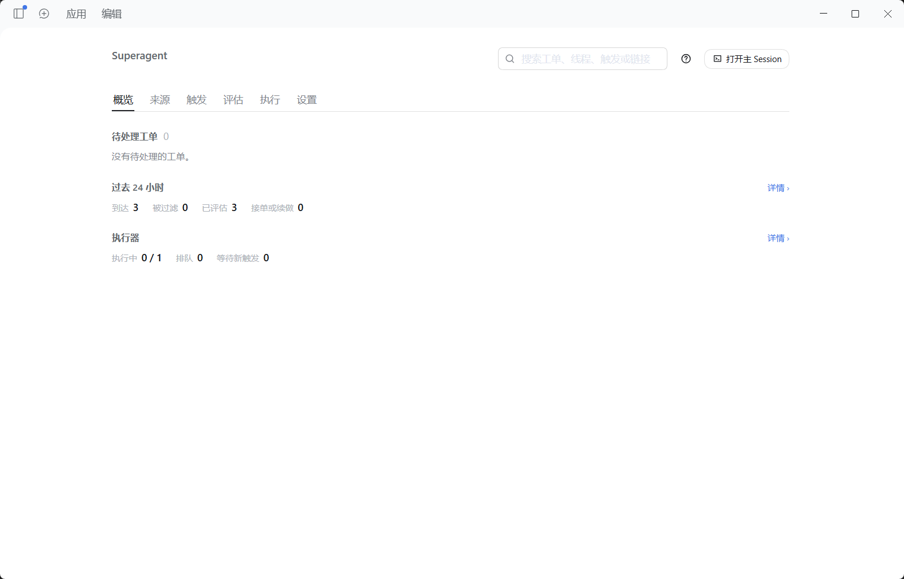

| 功能 | 用途与使用方法 |
| --- | --- |
| 待处理工单 | 集中展示正在等人提供信息或处理问题的工单。点击工单，按详情中的问题和可用操作处理 |
| 系统问题 | 有异常时才显示，例如部署检查失败、没有可用来源、没有授权用户、来源异常、评估未完成或回复发送失败。先读原因，再走对应的设置、重新检查或重试入口 |
| 过去 24 小时 | 观察到达、被过滤、已评估、接单或续做等数量。点「详情」进入相应记录；它统计的是最近 24 小时的流转量，不是历史累计，也不是 PR 数量 |
| 执行器 | 查看执行中数量 / 并发上限、排队数量和等待新触发的工单数。点「详情」进入执行页 |

**怎么用：** 打开面板后先处理异常和待处理工单。到达与评估数量在涨、接单却是 0，就去「评估」页看具体理由——是闲聊、验收消息，还是规则范围外，一眼能定位。

### 2. 来源：检查各渠道连接和收取状态

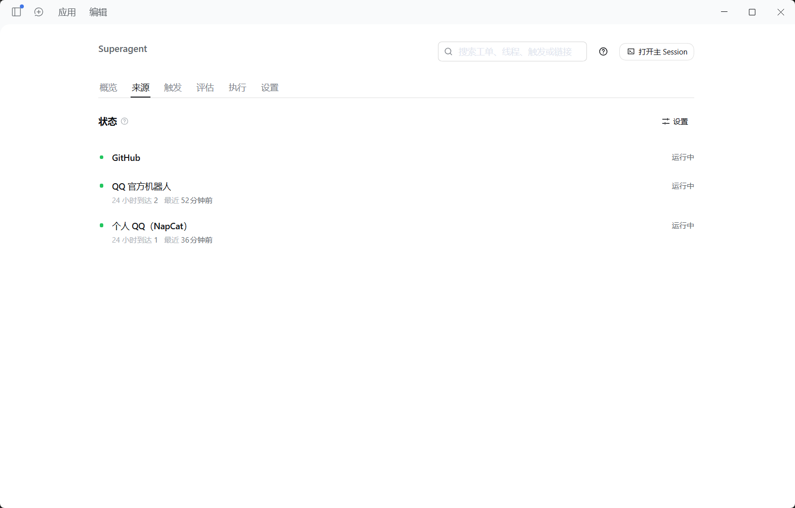

这里显示已注册来源的运行、关闭、等待检查或异常状态；有消息活动时显示相关统计与最近活动。被过滤和丢弃等统计按页面的时间窗口展示。**来源页负责看状态，改配置去「设置 → 来源」。**

**怎么用：**

1. 先确认目标渠道已启用且没有错误。个人 QQ 还需要 NapCat 进程运行、账号在线和反向 WebSocket 连接正常。
2. 点右上角「设置」进入配置，检查接收群、私聊开关、群内是否只接收 @ 等范围。
3. 发消息后到「触发」确认记录。连接正常意味着通道可用；能不能进任务流程，还要看接收范围、白名单和策略。

GitHub、QQ 官方机器人与个人 QQ 分别连接、分别授权。关掉某个来源只影响那条通道，其余照常运行。

### 3. 触发：追踪收到的消息和对话线程

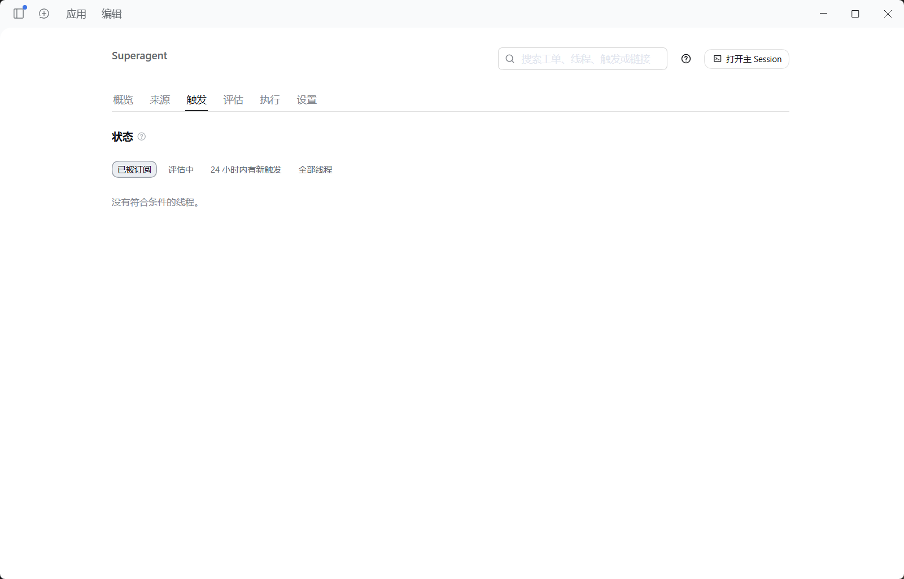

**触发**是收到的一条消息或事件，**线程**是承载相关消息的对话上下文，比如一个群聊或某个 Issue 的讨论。页面按线程归组，方便你顺着一条对话看完整脉络。

| 筛选或入口 | 用途与使用方法 |
| --- | --- |
| 已被订阅 | 查看已有工单关注的线程；后续相关消息可能继续投递给工单。这里的「订阅」指工单对线程的关注关系，和 QQ 的加群、加好友无关 |
| 评估中 | 找出当前正在等待研判完成的线程 |
| 24 小时内有新触发 | 刚发完验收消息时优先选这个筛选，确认最近是否收到消息 |
| 全部线程 | 查看包括没有被工单订阅在内的历史线程 |
| 线程详情 | 点击一条线程，查看触发内容、时间、评估决定及关联的工单订阅。已有工单接手的跟进消息会显示「已投递给工单」，继续投递给工单而不是每条都重新评估 |
| 重新评估 | 在满足条件的触发详情中出现，用于修复问题后再次评估；它会走一遍完整的授权与策略评估，不会强制接单 |

**怎么用：** 如果默认「已被订阅」为空，先切到「24 小时内有新触发」或「全部线程」。空列表只说明没有匹配当前筛选的线程，想确认是否收到过消息，换筛选或发条测试消息再看。

### 4. 评估：解释“为什么做，为什么不做”

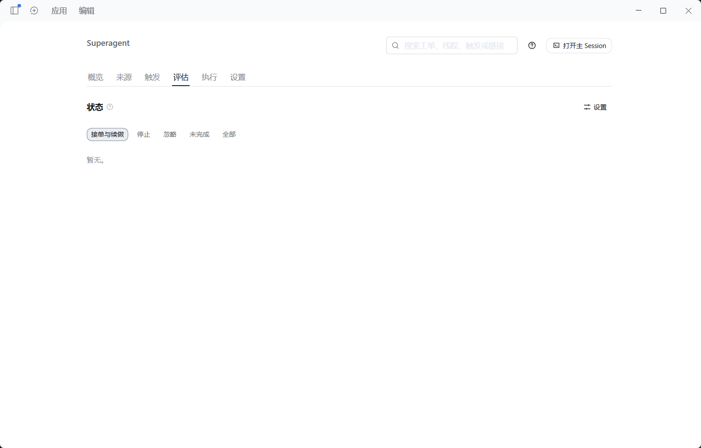

顶栏的「评估」展示**已经作出的决定**及理由、命中规则和关联记录；改规则点右上角「设置」，或进「设置 → 评估」。

| 筛选 | 表示什么 | 接下来怎么看 |
| --- | --- | --- |
| 接单与续做 | 已决定创建或重新开展工作 | 查看关联工单，再到「执行」跟踪实际进度 |
| 停止 | 评估产生了停止工作的决定 | 阅读停止理由和对应工单；它和执行页的全局暂停是两回事 |
| 忽略 | 消息被评估为不应开展工作 | 阅读理由，核对是否为普通聊天、验收消息、规则范围外的需求等 |
| 未完成 | 这次研判没有形成可用的决定，例如上下文读取或模型处理超时 | 查看原因，修复依赖或模型问题后，按详情中提供的入口重试 |
| 全部 | 一起查看各种决定 | 安装验收和排查「怎么没有回复」时优先使用 |

**怎么用：** 先读决定理由，再决定要不要改规则。默认「接单与续做」为空时，切到「忽略」或「全部」看验收消息的决定。评估通过只是进入工作流程，最终进度和 PR 是否合并到「执行」页看。

### 5. 执行：跟踪工单、排队与人工处理

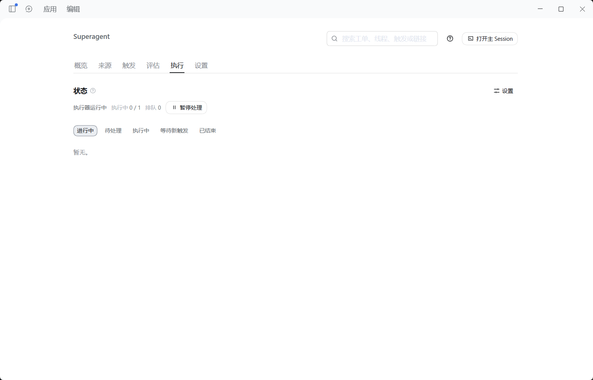

| 功能 | 用途与使用方法 |
| --- | --- |
| 执行器状态与负载 | 查看是否运行、正在执行的工单数及队列。超过并发上限的工作排队等空位 |
| 进行中 | 查看尚未结束的工单 |
| 待处理 | 查看需要人工输入或处理阻塞问题的工单；打开详情回应具体问题 |
| 执行中 | 查看正在开展工作的工单及其执行信息 |
| 等待新触发 | 查看等待后续对话或事件继续推进的工单；这是正常的等待状态 |
| 已结束 | 查看已结束工单的结果；结束原因可能是完成、PR 合并或人为停止，点开详情看具体原因 |
| 工单详情 | 查看原始触发、接单理由、授权范围、策略版本、执行安排、等待输入、订阅和报告。根据当前状态使用详情提供的操作；失败投递或受阻报告可能提供重试入口 |
| 暂停处理 / 恢复处理 | 全局暂停时，来源继续记录触发，但不再开始新评估、不派发新工作、不发送回复，直到恢复。它是针对「接单与派发」的开关，不切断来源连接，也不是立即杀掉所有运行进程的急停按钮 |

**怎么用：** 「接单了但没动静」时，先看是否暂停、是否排队，再进工单看它在等什么。要调整模型、并发或准备命令，走右上角「设置 → 执行」。

### 6. 设置：决定接入范围、授权和执行方式

设置分 **来源、评估、执行、提示词、部署** 五组。改完后在对应配置块出现的保存栏点「保存」；不想保留就「放弃修改」。支持配置历史的分组可展开「配置历史」看变更记录。保存动作是显式的——光切页面或打字不会生效。

#### 6.1 来源设置：连接账号和选择收取范围

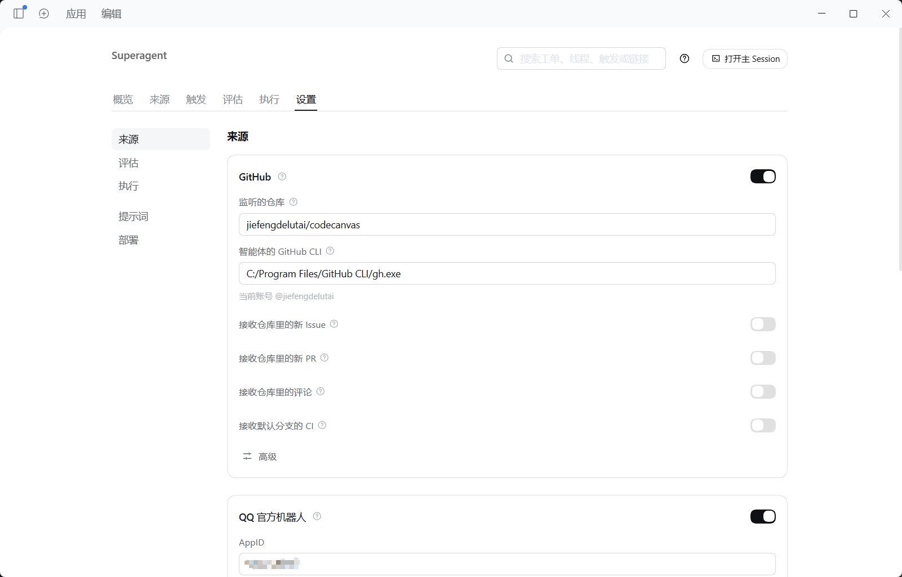

| 配置项 | 用途与使用方法 |
| --- | --- |
| 来源开关 | 启用或停用当前渠道；没准备好的来源保持关闭 |
| GitHub | 填写 `owner/repository` 和已登录账号的 `gh` 命令名或绝对路径。账号需具备目标仓库所需权限；CLI 字段填命令名或可执行文件路径即可，不要填 `gh repo clone ...` 这样的整条命令 |
| GitHub 事件开关 | 选择是否额外接收没有 @ 智能体的新 Issue、新 PR、评论和默认分支 CI。打开只是扩大收取范围，能不能成为任务仍由策略和评估决定 |
| 高级参数 | 调整来源的轮询间隔、连续失败阈值或读取上限等。GitHub 要求更长轮询间隔时以平台要求为准；初次使用保留默认值 |
| QQ 官方机器人 | 配置 AppID、AppSecret、机器人 OpenID、群 OpenID、各群接收模式、其他群策略与私聊开关。这里要用 API 的 OpenID，不能用数字 QQ 号或群号代替 |
| 个人 QQ | 配置已登录小号的数字 QQ 号、访问令牌、NapCat HTTP 地址、接收群与私聊开关；高级项提供本机反向 WebSocket 监听地址、端口和路径等 |
| 飞书 | 来源已安装并注册时，配置机器人 CLI、接收会话与相关接收范围；具体字段以当前来源卡片为准 |

**怎么用：** 先把范围缩到一个测试仓库或测试群。QQ 的 Token 只在本机填写，HTTP 和反向 WebSocket 两端保持一致。保存仓库、账号等关键字段以及 QQ 来源配置可能触发重新检查或运行时重连，之后回「来源」页核对状态。

#### 6.2 评估设置：谁能发起工作，以及什么值得接单

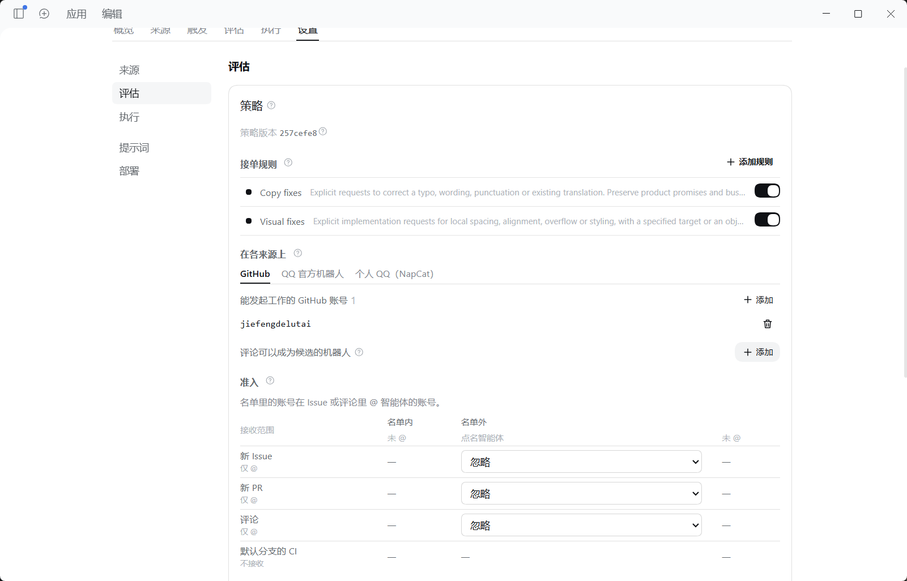

| 配置项 | 用途与使用方法 |
| --- | --- |
| 策略版本 | 记录当前规则、来源策略与接单模式的版本，方便追溯工单当时按什么授权接下；修改相关设置会生成新版本 |
| 接单规则 | 添加、编辑、复制、启用或删除规则。写清能做什么、不能做什么和验收边界；一条清晰的小规则比一句「所有需求都处理」可靠得多。图中的 Copy fixes / Visual fixes 是本机规则示例，你可以按自己的业务来定义 |
| 在各来源上 | 分别维护控制者白名单。GitHub 用登录名，官方 QQ 用 `AppID:用户OpenID`，个人 QQ 用 `小号QQ:用户QQ`。不同来源是独立身份体系，各自维护名单 |
| 成员同步与机器人名单 | 支持这些能力的来源可同步成员，或指定哪些机器人事件成为候选。有同步按钮的来源才有这项能力；被列为候选的机器人消息还要进一步研判才会成为明确工作 |
| 准入表 | 按接收范围、是否在名单内、是否点名智能体，把消息分为明确请求、推断候选或忽略。收不到的消息类型显示为不可用；先把陌生人的请求保持收紧，确认行为可靠后再逐步放开 |
| 评估时限 | 限定单次研判等待时间；超时会留下未完成记录，结合模型和上下文读取情况排查 |
| 研判模型 | 选择负责理解需求和路由的主 Session 模型；留空继承 Harness 默认值。保存后的选择用于新建的主 Session，已有会话按各自创建时的模型继续 |

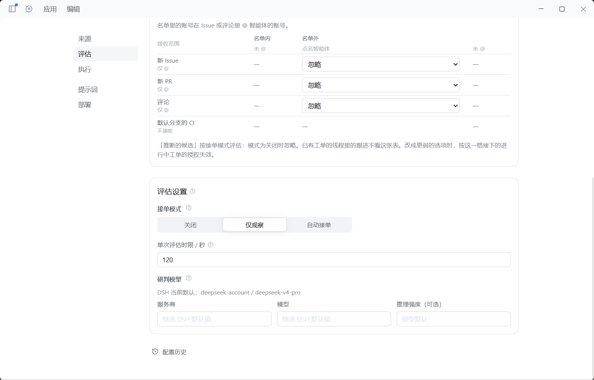

**接单模式管的是「推断的候选」怎么处理，它是一层针对「没人明确点名」场景的开关：**

| 模式 | 推断候选的行为 | 明确请求 |
| --- | --- | --- |
| 关闭 | 不评估其他触发 | 仍可按授权与规则处理 |
| 仅观察 | 评估并记录研判，但不因推断候选而接单 | 仍可按授权与规则处理 |
| 自动接单 | 候选符合规则时可以接单 | 仍须满足授权与规则 |

**怎么用：** 先配置少量可信控制者和边界清楚的规则，再决定是否允许推断候选自动接单。验收时想完全不干活，就明确发送「不创建工单、不修改文件」的验收消息，或用执行页的暂停功能；「仅观察」负责记录研判，不负责拦住明确请求。

#### 6.3 执行设置：配置实际干活的模型与环境

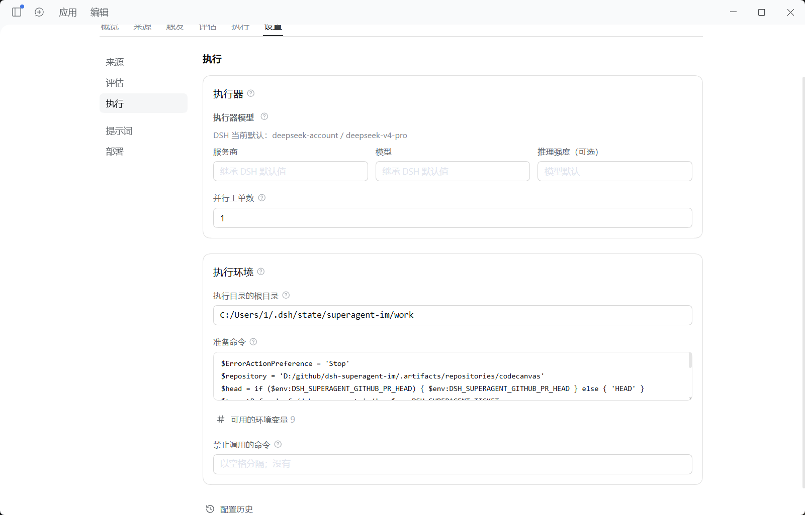

| 配置项 | 用途与使用方法 |
| --- | --- |
| 执行器模型 | 为执行代码修改等工作的 Session 选择模型、服务商及可选推理强度；与评估模型分开设置。留空继承 Harness 默认值，变更用于新建的执行器 Session |
| 并行工单数 | 控制同时运行的工单上限，超出部分排队。初次使用建议从 1 开始，根据资源和仓库工作流再增加 |
| 执行目录的根目录 | 每个工单在根目录下有独立工作目录。用本机绝对路径，留空用默认目录；目录隔离带来的是工作区相互独立，它本身不是操作系统级安全沙箱 |
| 准备命令 | 为新工单建立执行环境，例如通过 `git worktree` 检出仓库。留空会得到空目录，不会自动准备目标仓库。Windows 用 PowerShell，其他系统用 `sh`，变量写法要匹配对应 shell |
| 可用的环境变量 | 展开查看当前执行器与来源提供的变量及说明，用于准备命令。点击变量可插入文本，Windows 下注意核对 PowerShell 的 `$env:变量名` 语法 |
| 禁止调用的命令 | 按命令名阻止部分调用，例如避免误用个人账号 CLI。它是行为约束，做不了安全边界——绝对路径调用仍可能绕过，真正的隔离要靠专用系统账号 |

**怎么用：** 先保证准备命令能为每个工单生成可用的仓库目录，再增加并发。截图里的绝对路径与脚本是本机示例，换成你自己的环境。自动合并和 PR 交付要求写在团队交付提示词与仓库权限里，它们不是调并发就自动开启的能力。

#### 6.4 提示词设置：约定沟通、提交和交付规则

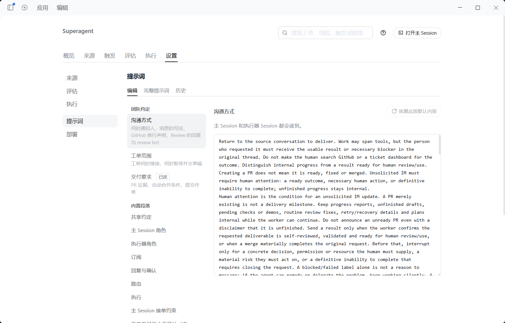

| 功能 | 用途与使用方法 |
| --- | --- |
| 编辑 | 修改团队约定、内置段落和技能。常用团队约定包括如何沟通、何时通知、工单范围、提交身份、PR 交付与审阅要求 |
| 完整提示词 | 查看最终组装给模型的内容，核对多段设置合在一起是否一致，并按页面提供的选项比较版本 |
| 历史 | 查看提示词版本与变更，排查「修改后行为为什么变了」 |
| 恢复此段默认内容 | 对已覆盖的内置段落恢复默认值；恢复后也按页面提示保存 |
| 默认内容已更新 | 升级后，旧的自定义覆盖可能需要与新的默认内容比较，再决定保留自己的还是换用新默认；团队约定要谨慎覆盖 |

**怎么用：** 优先在团队约定里写清沟通语言、提交格式、PR 审阅和「不要自动合并」等要求。修改模板时保留必需占位符，保存后用「完整提示词」复核。提示词负责行为指导，真正的边界由白名单、平台权限和操作系统隔离共同构成。

#### 6.5 部署设置：查看启动问题和本机资源上限

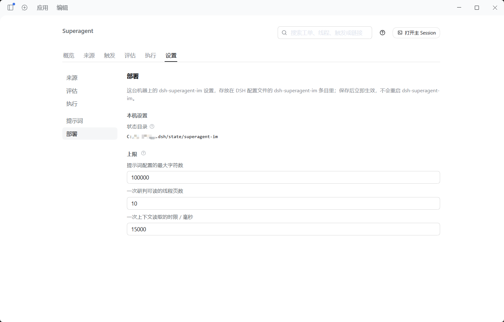

| 配置项 | 用途与使用方法 |
| --- | --- |
| 部署检查与重新检查 | 有启动检查问题时，页面提供原因与重新检查入口。修复 CLI 登录、可执行文件路径等外部条件后再检查，靠反复重启猜不出原因 |
| 状态目录 | 显示数据库、锁、工作命令与 Git 配置的存放位置。此页只读，修改要去 Harness 的插件配置；运行中的状态目录不要随手删除 |
| 提示词配置的最大字符数 | 限制保存的提示词配置大小，避免配置无限膨胀 |
| 一次研判可读的线程页数 | 限制一次评估能读多少页历史上下文，平衡上下文完整性与资源消耗 |
| 一次上下文读取的时限 | 限制单次上下文读取等待时间，单位毫秒；与「评估设置」里以秒计的整次评估时限是两项不同设置 |

**怎么用：** 初次使用保留资源上限默认值。上下文读取经常超时或历史过多时，再结合日志与实际负载调整。可编辑的资源上限保存后即时生效；更换状态目录属于插件配置变更，按对应流程处理。

### 常用辅助入口与排查顺序

顶部搜索支持查找触发文本、ID、已保存的链接、线程引用和工单标题；范围是系统已经记录或读取过的内容。旁边的「术语表」解释触发、线程、评估、工单等概念；「打开主 Session」用于查看调度会话，日常使用无需直接操作它。

| 遇到的问题 | 建议从哪里查 |
| --- | --- |
| 发消息后没反应 | 来源状态 → 接收范围 → 触发的最近 / 全部线程 |
| 收到了却不接单 | 评估的全部 / 忽略 → 设置中的来源白名单、准入表和规则 |
| 已接单但不执行 | 执行页的暂停状态、队列和工单详情 → 准备命令与模型 |
| 执行后没有回复 | 概览中的回复异常、工单报告、来源连接与平台发送权限 |
| 修改配置没生效 | 确认已保存 → 配置历史 → 来源重连或新 Session 的模型选择 |

## 使用演示

下面是我已经完成的接入演示：QQ 官方机器人和个人 QQ 两条通道，测试消息成功进入评估。

### 1. 确认消息来源已连接

在 Superagent 的「来源」页检查状态。QQ 官方机器人和个人 QQ（NapCat）是两个独立来源；按你自己的需要启用即可，只用 GitHub 就只启用 GitHub。


### 2. 发一条不执行任务的验收消息

先把发消息的账号加进控制者白名单，并把测试群设为「仅 @」。在群里 **@实际接入的机器人或小号**，发送：

```text
接入验收，请勿创建工单、修改文件或发起 PR。
```

随后检查「触发」和「评估」，并在「概览」确认消息已经到达和完成评估。下图中到达 3 条、已评估 3 条、接单 0 条——这正是「不创建任务」的验收结果。


### 3. 再提交真实任务

验收通过后，在允许的群中 @账号，明确目标仓库、问题和验收标准。例如，已配置文案修正规则时可以发送：

```text
请处理当前配置的仓库：README 的安装章节中有一处命令拼写错误。
请核对 package.json 中的实际脚本并修正文档，只修改相关文字。
验收标准：命令与项目脚本一致，保留其他章节；完成后创建 PR，不要自动合并。
```

这是一段任务写法示例，实际是否接单取决于你的授权、接单模式、任务规则、模型和执行器配置。通过评估后，就能在面板跟踪工单与执行状态；没接单时先看「评估」页的理由和策略。这段演示只验证了消息接入与评估，真实的任务修改和 PR 交付留给你自己在目标仓库上跑通。

## 安装与配置

我在 Windows、DeepSeek Harness 桌面版 `0.2.2-rc.2` 上验证了插件启动，以及两种 QQ 来源的消息接入与评估。其他平台和完整交付场景请按自己的环境验收；目前仍是预览版本。

### 方式一：把安装提示词发给 AI（推荐）

找一个能访问本机终端、读写文件并联网的编程 AI，把下面整段提示词复制给它，就能开始安装，无需先手动拉仓库。普通聊天 AI 能给你指导，但操作不了你的电脑；GitHub 授权、QQ 扫码和密钥输入这些需要你本机完成。

```text
请用中文帮我安装并配置 DeepSeek Harness 插件 dsh-superagent-im：
https://github.com/jiefengdelutai/dsh-superagent-im

请实际执行安装，不要只给出操作教程。按以下步骤完成：

1. 先检查操作系统、Harness 安装位置和正在使用的 profile，以及 Node.js、pnpm、Git、GitHub CLI 与模型配置。保留已有账号和插件配置；已经完成的步骤不要重复操作。
2. 将仓库克隆到合适的本地目录，阅读 README.md、SECURITY.md 和 SETUP.md。SETUP.md 及英文部署指南包含 Unix 示例，Windows 上请根据当前代码使用适用的 PowerShell 命令，不要照搬 shell 脚本。
3. 只询问无法从本机判断的信息：需要接入的消息来源、目标 GitHub 仓库、执行账号、控制者白名单，以及需要接收消息的群。不要让我在聊天中提供密码、AppSecret、Token 或登录缓存；需要授权时，引导我在本机完成。
4. 说明将要安装的组件和使用的权限，再按照我的选择安装依赖、构建插件，并用 Harness 自带 CLI 将本地插件目录添加到正确的 profile。执行 pnpm install --frozen-lockfile 和 pnpm build，确认插件启动及部署检查结果。
5. 配置状态目录、GitHub CLI、控制者白名单、任务策略和执行目录。CLI 字段只填写命令名或可执行文件绝对路径，不要填写整条命令。初期关闭自动合并，不执行实际代码修改或创建 PR 来测试安装。
6. 若选择 QQ 官方机器人，阅读 docs/qq-official.md，区分 AppID、机器人身份、用户 OpenID 和群 OpenID，避免与独立聊天插件争用同一个机器人连接。
7. 若选择个人 QQ，阅读 docs/qq-onebot.md，解释 NapCat 风险后使用专用小号。NapCat 是额外依赖，仓库里只存档源码，不含可直接安装的运行包；运行前先核实运行包来源与授权，不自动运行未知安装器。WebUI 和 OneBot 仅绑定 127.0.0.1，设置独立强随机令牌，不开启公网端口。
8. 检查来源连接状态，引导我发送不创建工单、不修改文件、不发起 PR 的验收消息，并核对消息是否进入 Superagent 及完成评估。验收消息没有聊天回复属于正常现象，不必认定为接入失败。
9. 最后报告已完成项目、验证结果、仍需我操作的步骤，以及重启和停用方法。遇到错误先查看脱敏日志并定位原因；不要输出密钥，不要通过关闭系统防护解决问题，也不要声称未验证的功能已经可用。
```

### 方式二：手动安装

准备 Node.js `^22.19.0` 或 `>=24.0.0`、pnpm `11.7.0`、Git、GitHub CLI，以及已配置模型的 DeepSeek Harness。安装源码：

```sh
git clone https://github.com/jiefengdelutai/dsh-superagent-im.git
cd dsh-superagent-im
pnpm install --frozen-lockfile
pnpm build
```

在 Harness 的插件管理中添加本地目录；也可以用 Harness 自带的 `dsh` CLI，为实际使用的 profile 添加 `link:<插件目录绝对路径>`：

```sh
dsh plugin --profile desktop add "link:<插件目录绝对路径>"
```

把占位符换成本机路径。`desktop` 对应桌面版默认 profile，其他部署用你自己的 profile 名称。若 `dsh` 不在 PATH，就用安装目录内的 CLI。保留源码目录，升级后重新构建并重启 Harness。

打开 Superagent 面板，设置绝对路径的状态目录、目标 GitHub 仓库、已登录的 GitHub CLI、控制者白名单，以及执行目录和准备命令。CLI 字段填 `gh` 或可执行文件的绝对路径，不要填 `gh repo clone ...` 这样的命令。Windows 准备命令用 PowerShell，其他系统用 `sh`。

QQ 接入分别读 [官方机器人](docs/qq-official.md) 或 [个人 QQ / NapCat](docs/qq-onebot.md)，两者可以独立启用。首次验收在允许的测试群 @账号发送「接入验收，请勿创建工单、修改文件或发起PR」，在面板确认消息进入并完成评估；普通聊天和验收消息不会被当作任务，也不会自动创建工单。

**权限提示：执行器以当前操作系统用户权限运行，工作目录和会话隔离提供的是工作区相互独立，不是操作系统沙箱。** 建议使用专用系统账号和 GitHub 账号，先限制到测试仓库与测试群，保持控制者白名单并关闭自动合并。密钥只在本机配置，不要发到聊天、Issue 或提交到 Git。详见 [安全说明](SECURITY.md) 与 [完整部署指南](docs/006-deployment.md)。

首次使用建议先在测试仓库和测试群验收，再扩大授权范围。[SETUP.md](SETUP.md) 是沿用原型的助手部署流程参考，部分步骤面向 Unix 环境；Windows 用户以本文及 QQ 中文指南为入口，其中的 shell 脚本按 PowerShell 改写后再用。

## 文档导航

以下编号文档沿用原型的技术说明，正文目前仍以英文为主；中文标题用于导航。安装入口、安全说明与 QQ 接入指南已用中文写好。

- [000 设计理念](docs/000-philosophy.md)
- [001 领域模型](docs/001-domain.md)
- [002 授权机制](docs/002-authorization.md)
- [003 执行机制](docs/003-execution.md)
- [004 提示词](docs/004-prompts.md)
- [005 管理面板](docs/005-panel.md)
- [006 部署、升级与排障](docs/006-deployment.md)
- [007 项目架构](docs/007-architecture.md)
- [008 扩展消息来源](docs/008-cookbook.md)

QQ 提供两条相互独立的接入路径：

- [QQ 官方机器人](docs/qq-official.md)：适合正式群机器人和私聊机器人，使用 QQ 开放平台身份。
- [个人 QQ（NapCat / OneBot v11）](docs/qq-onebot.md)：适合个人 QQ 号，存在账号风控和非官方协议风险。

两种通道可以同时启用，OpenID 与数字 QQ 号是两套独立身份，不互相映射。无凭据的插件启用示例见 [examples/qq.cordis.patch.yml](examples/qq.cordis.patch.yml)。

## 开发与验证

```sh
pnpm typecheck
pnpm test
pnpm build
```

`pnpm check` 依次执行类型检查、完整测试和构建。当前类型检查、构建及相关 QQ / Windows 测试已通过；本机 Windows 上的完整测试套件仍受 Unix 命令、符号链接权限和脚本兼容问题影响，我还在持续跟进，项目目前处于预览阶段。

报告问题时，请说明操作系统、Harness 与 Node 版本、来源类型和复现步骤。只提供脱敏日志，不上传密钥、登录缓存、二维码或聊天记录。参见 [安全说明](SECURITY.md)。

## 来源与许可证

本项目沿用 [MIT 许可证](LICENSE)，并保留原型的版权声明。仓库由 `jiefengdelutai` 维护；新的提交历史不改变原始代码的版权归属。

NapCat 是接入个人 QQ 时需独立安装的第三方程序，不在本插件内。我从社区归档 fork 并保留了 [v4.18.42 固定源码](https://github.com/jiefengdelutai/NapCatQQ-archive/releases/tag/v4.18.42)，对应本机接入验收使用的版本。该仓库仅存档源码，没有托管安装过程中用到的全部运行包或 QQ 原生组件。
